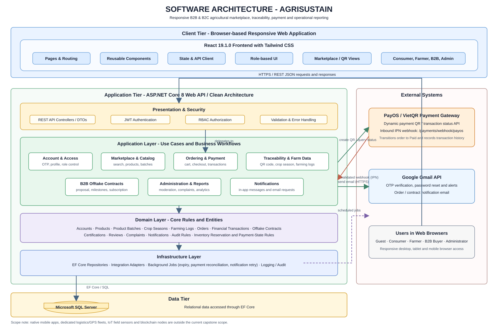

# Software Architecture - AgriSustain

## Component explanation

| Component | Responsibility |
|---|---|
| Client tier | A responsive React 19.1.0 web application styled with Tailwind CSS. It supplies views appropriate to Guests, Consumers, Farmers, B2B Buyers, and Administrators; it communicates with the backend over HTTPS using REST/JSON. |
| Presentation and security | ASP.NET Core 8 Web API controllers expose REST endpoints. JWT authentication, role-based access control, validation, and centralized error handling protect all private operations. |
| Application layer | Coordinates the use cases specified in the SRS: account management, catalog browsing, product/batch management, cart and order processing, payment, traceability, B2B offtake contracts, administration, reporting, and notifications. |
| Domain layer | Holds the business entities and rules. Important rules include inventory reservation during checkout, permitted order-state transitions, payment confirmation, QR batch uniqueness, permissions, and audit requirements. |
| Infrastructure layer | Implements persistence through repositories and EF Core, encapsulates external API adapters, executes operational background jobs, and records logs/audit events. Scheduled jobs cover expired-payment cancellation, payment-status reconciliation, and failed-notification retry. |
| Data tier | Microsoft SQL Server is the primary relational store. EF Core maps domain data such as accounts, products, batches, farming logs, orders, financial transactions, contracts, certifications, reviews, complaints, and notifications. |
| PayOS / VietQR | The payment adapter requests dynamic QR payments and may query transaction status. The gateway sends an inbound IPN webhook; after validation, the system changes the order state to `Paid` and writes transaction history. |
| Google Gmail API | Sends account-verification OTPs, password-reset email, order confirmation/alerts, and relevant contract notifications. Failed deliveries are retried by the notification worker. |
| Users in web browsers | Guests can browse public marketplace and traceability data. Signed-in users receive functions according to their roles; the browser is not a separate trusted subsystem. |

## Main communication paths

1. The React client calls the Web API with HTTPS/REST JSON. The API authenticates the user, checks authorization and validates input before calling an application use case.
2. Application use cases enforce domain rules, then obtain or update data through infrastructure repositories and EF Core in SQL Server.
3. When a consumer selects PayOS/VietQR, the payment adapter creates a QR payment request. Payment completion becomes authoritative only after the validated webhook (or reconciliation job) updates the payment/order record.
4. The notification service sends the selected messages through Gmail and keeps failed deliveries available for retry.

## Architecture basis

This diagram follows the latest internally consistent technology decisions in the three supplied reports: Report 2 identifies React 19.1.0, ASP.NET Core Web API 8.0, EF Core, SQL Server and Azure staging deployment; Report 3 specifies PayOS/VietQR webhook and Google Gmail API integrations, background jobs, role-based access, and the core business domains. A conflicting older sentence in Report 2 that says “ASP.NET Core MVC” is not reflected because the same report later establishes a decoupled React frontend and ASP.NET Core Web API backend.
